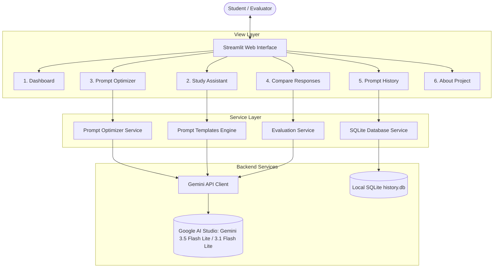
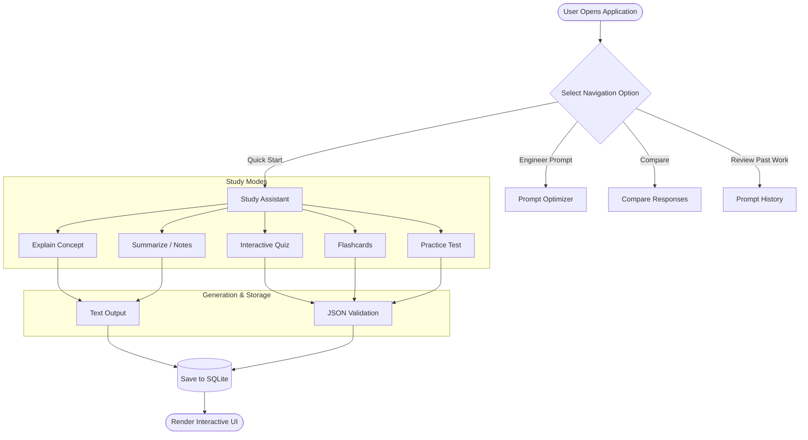
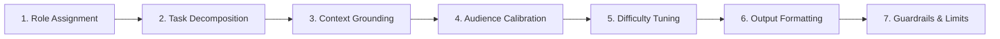

# 📚 PromptWise: AI-Powered Study Assistant

> **"Learn Smarter. Prompt Better."**  
> SCSE4041 Prompt Engineering Coursework Project • Team Cognivance • Milestone 2 Prototype

[](https://promptwise-a7i9rzr9og3ef8hqi26nub.streamlit.app/)
[](https://python.org)
[](https://aistudio.google.com)
[](https://opensource.org/licenses/MIT)

**🌐 Live Prototype Application:** [https://promptwise-a7i9rzr9og3ef8hqi26nub.streamlit.app/](https://promptwise-a7i9rzr9og3ef8hqi26nub.streamlit.app/)<br>
**💻 Source Code Repository:** [https://github.com/Yaditiarora/PromptWise](https://github.com/Yaditiarora/PromptWise)

---

## 📖 Project Overview & Academic Scope

PromptWise is an academic AI study assistant prototype developed as a university coursework project to investigate and demonstrate how **Prompt Engineering** techniques influence Large Language Model (LLM) responses for educational use cases. Built using **Python**, **Streamlit**, **Google's Gemini API**, and **SQLite**, the prototype transforms unstructured student queries into structured, role-grounded prompts that align outputs with specific academic levels, active recall study formats, and examination requirements.

### 🎯 Problem Statement
Students using general-purpose AI interfaces often experience:
1. **Ambiguous or Unfocused Outputs:** Vague queries (e.g., *"Explain photosynthesis"*) frequently produce unformatted, generic, or excessively verbose responses.
2. **Cognitive Level Mismatch:** Responses are often not calibrated to the learner's academic stage (School vs. Undergraduate vs. Postgraduate).
3. **Passive Reading vs. Active Recall:** Standard chat models lack built-in active recall mechanisms such as flashcard flipping, self-quizzing, and timed practice tests.
4. **Unstructured Exam Preparation:** Students preparing for Indian university exams require answers formatted for specific mark weightages (2, 5, or 10 marks) with explicit point breakdowns.

### 💡 Project Objectives
- **Operationalize Prompt Engineering:** Implement a structured **7-Pillar Prompt Engineering framework** (Role, Task, Context, Audience, Difficulty, Format, Guardrails).
- **Provide Multi-Mode Study Tools:** Offer 5 dedicated study modes (Explain, Summarize, Interactive Quiz, Flashcards, Practice Test) plus marks-based exam answers.
- **A/B Response Comparison:** Provide side-by-side comparison of responses generated from basic versus engineered prompts under identical temperature settings (0.7).
- **Session Persistence:** Store study sessions and prompt variations in a local SQLite database with search and filtering capabilities.
- **Academic Evaluation:** Evaluate response quality across 5 qualitative criteria using LLM-assisted rubric heuristics while documenting evaluation limitations.

---

## 👥 Team Cognivance

| Enrollment No. | Student Name | Role | Project Contributions |
|---|---|---|---|
| **S24CSEU0166** | **Vanshika Beniwal** (Leader) | Prompt Architect | Prompt design, 7-pillar template specification, qualitative rubric calibration, testing |
| **S24CSEU0241** | **Yaditi Arora** | Full-Stack & AI Engineer | Application architecture, Streamlit UI implementation, Gemini API integration, SQLite persistence, deployment |
| **S24CSEU0340** | **Mohita Purohit** | QA & Product Analyst | Test execution, comparative response benchmarking, documentation, demonstration preparation |

---

## 🏛️ System Architecture

PromptWise follows a modular structure separating the user interface, service tier, prompt templates, AI model integration, and local persistence.

### Architecture Diagram



### Application Workflow



---

## 🔬 The 7 Pillars of Prompt Engineering

The prototype applies prompt engineering through seven foundational pillars:



1. **Role Assignment:** Assigns an explicit academic tutor persona tailored to the subject domain.
2. **Task Decomposition:** Structures learning requests into clear, sequential steps (definition, mechanisms, application, takeaways).
3. **Context Grounding:** Focuses explanations on academic concepts and course curricula.
4. **Target Audience Calibration:** Adjusts vocabulary and tone for School, Undergraduate, or Postgraduate levels.
5. **Difficulty Tuning:**
   - *Beginner:* Simple language, foundational analogies, zero assumed prerequisites.
   - *Intermediate:* Academic terminology, functional mechanisms, practical examples.
   - *Advanced:* Theoretical depth, edge cases, analytical trade-offs.
6. **Output Formatting:** Enforces Markdown headings, bold terms, bullet points, and memory tips.
7. **Guardrails & Constraints:** Directs the model to stay within academic topics, bound answer lengths, and prevent speculation on uncertain facts.

---

## 🗄️ Database Schema (SQLite)

The local SQLite database (`code/data/history.db`) records student sessions and prompt comparisons.

### Table: `prompt_history`

| Column | Type | Description |
|---|---|---|
| `id` | `INTEGER PRIMARY KEY AUTOINCREMENT` | Session identifier |
| `timestamp` | `TEXT NOT NULL` | Session creation time (`YYYY-MM-DD HH:MM:SS`) |
| `topic` | `TEXT NOT NULL` | Academic subject or query topic |
| `study_mode` | `TEXT NOT NULL` | Feature mode (`Explain`, `Summarize`, `Quiz`, `Flashcards`, `Test`, `Comparison`, etc.) |
| `difficulty` | `TEXT NOT NULL` | Selected level (`Beginner`, `Intermediate`, `Advanced`) |
| `original_prompt` | `TEXT NOT NULL` | User input prior to optimization |
| `optimized_prompt`| `TEXT` | Prompt-engineered template sent to the API |
| `generated_response`| `TEXT NOT NULL` | AI response content or structured JSON |
| `metadata_json` | `TEXT` | JSON payload containing scores, question arrays, or rubric items |

### Indexes:
- `idx_topic`: B-Tree index on `topic` for keyword search queries.
- `idx_mode`: Index on `study_mode` for mode filtering.
- `idx_difficulty`: Index on `difficulty` for level filtering.
- `idx_timestamp`: Index for chronological ordering.

---

## 🌟 Application Features

### 1. Dashboard
- Real-time counters showing saved sessions, quiz attempts, and feature usage.
- 3-and-2 card grid for direct 1-click access to each study mode.
- System status badge distinguishing between client configuration and live API verification.

### 2. Study Assistant
- **📖 Explain:** Conceptual definitions, step-by-step breakdown, real-world analogies, and core takeaways.
- **📝 Summarize (Notes):** Concise bullet points, bold key terms, formulas, and mnemonic memory aids.
- **❓ Interactive Quiz:** 5 multiple-choice questions with 4 options (`A`–`D`), immediate radio-button answering, instant score calculation, and question explanations.
- **🗂️ Interactive Flashcards:** 3D card-flip animation, Previous/Next navigation, shuffle function, and self-assessment mastery tracking (*Mastered* vs. *Need Revision*).
- **⏱️ Practice Test:** Timed practice test with configurable question counts, mixed question formats, elapsed timer, and automated feedback with revision suggestions.
- **📝 Marks-based Exam Answers:** Calibrated answer structures for 2-mark (short definition), 5-mark (4 structured points), and 10-mark (comprehensive essay with intro, body, and conclusion) Indian university exam patterns.
- **🌐 Bilingual Mode:** Optional conversational Hinglish (Roman script) output while preserving technical English terminology.

### 3. Prompt Optimizer
- Transforms basic student prompts into structured prompts incorporating the 7 prompt engineering pillars.
- Configurable controls for Target Audience, Difficulty, Desired Output Format, and Custom Constraints.
- Displays the original prompt, optimized prompt, and an explanation of improvements with 1-click copy support.

### 4. Compare Responses (A/B Benchmarking)
- Generates side-by-side responses to the same topic under identical generation settings (`temperature=0.7`):
  - **Response A:** Basic, unguided prompt.
  - **Response B:** 7-pillar optimized prompt.
- **Automated Rubric Evaluation (5 Criteria, 1–10 Scale):**
  1. *Relevance:* Adherence to the core topic.
  2. *Clarity:* Readability and accessibility.
  3. *Completeness:* Depth and coverage of key sub-concepts.
  4. *Structure:* Section hierarchy, headings, and formatting.
  5. *Difficulty Alignment:* Calibration to the selected educational level.
- Computes overall scores, score difference, and qualitative criteria commentary.

> [!NOTE]
> **Academic Note on Automated Evaluation & Illustrative Scores:** Automated LLM scoring is implemented strictly as an educational heuristic to illustrate comparative differences across rubric dimensions. Numerical scores (such as the 7.4/10 vs. 9.6/10 sample result in TC-15) represent an illustrative single-run experiment on a sample prompt, rather than broad scientific proof or formal human grading across all academic domains.

### 5. Prompt History
- SQLite-backed history table with keyword search and multi-factor filtering by mode and difficulty.
- Expandable session viewer showing prompts and generated responses.
- **"Load in Study Assistant"** button to resume previous topics in the Study Assistant.
- Individual session deletion and bulk clear options.

---

## 🧪 Verification & Testing Matrix

The prototype includes an automated test suite (`code/test_promptwise_suite.py`) validating functionality and error handling.

| Test ID | Module | Test Scenario | Expected Result | Actual Result | Status |
|---|---|---|---|---|---|
| **TC-01** | Database Service | Schema initialization & index creation | Table `prompt_history` and 4 indexes exist | Verified table & indexes created | ✅ PASS |
| **TC-02** | Database Service | CRUD operations (insert, fetch, delete) | Session inserted, retrieved by ID, and deleted | Inserted ID, verified match, deleted cleanly | ✅ PASS |
| **TC-03** | Database Service | Multi-factor filtering & keyword search | Filters by mode and difficulty; search matches substring | Returned matching records correctly | ✅ PASS |
| **TC-04** | Gemini Service | API credentials resolution | Loads API key from Streamlit secrets or env var | Client initialized successfully | ✅ PASS |
| **TC-05** | Gemini Service | Primary model generation (`gemini-3.5-flash-lite`) | Receives response text from primary model | Response received: `Working` | ✅ PASS |
| **TC-06** | Gemini Service | Fallback model generation (`gemini-3.1-flash-lite`) | Receives response text from fallback model | Response received: `Working.` | ✅ PASS |
| **TC-07** | Gemini Service | Invalid API key error handling | Raises clear error without retrying | Raises `RuntimeError` immediately | ✅ PASS |
| **TC-08** | Gemini Service | JSON parser & LaTeX escape resilience | Decodes fenced JSON and sanitizes LaTeX backslashes | Cleanly parsed into Python dict | ✅ PASS |
| **TC-09** | Prompt Optimizer | 7-Pillar prompt expansion | Generates structured prompt with role, task, guardrails | Expanded prompt to 948 chars | ✅ PASS |
| **TC-10** | Study Assistant | Mode A: Explain generation | Structured explanation with analogies and takeaways | Generated 3,975 chars of structured output | ✅ PASS |
| **TC-11** | Study Assistant | Mode B: Summarize generation | Bulleted revision notes with bold terms & memory tips | Generated 3,451 chars of revision notes | ✅ PASS |
| **TC-12** | Study Assistant | Mode C: Interactive Quiz generation | 5 MCQs with options A–D, answer keys, explanations | Parsed 5 MCQs with options `['A', 'B', 'C', 'D']` | ✅ PASS |
| **TC-13** | Study Assistant | Mode D: Flashcards generation | 6 conceptual cards with front and back text | Parsed 6 cards with valid front/back | ✅ PASS |
| **TC-14** | Study Assistant | Mode E: Practice Test generation | Mixed MCQs and conceptual questions with rubric | Parsed 3 mixed questions with answer keys | ✅ PASS |
| **TC-15** | Compare Responses| A/B comparison & heuristic evaluation | Both responses generated; heuristic evaluation completed | Basic: 7.0/10, Optimized: 8.6/10, Winner selected | ✅ PASS |
| **TC-16** | Error Handling | Empty topic submission validation | Warning displayed; no unhandled API call made | Warning: "Please provide a study topic" | ✅ PASS |

To execute the test suite locally:
```bash
python code/test_promptwise_suite.py
```

---

## 🚀 Local Installation & Setup

### Prerequisites
- Python 3.10 to 3.14
- Google Gemini API Key ([Google AI Studio](https://aistudio.google.com/))

### Setup Steps
1. **Clone the repository:**
   ```bash
   git clone https://github.com/Yaditiarora/PromptWise.git
   cd PromptWise
   ```

2. **Create and activate a virtual environment:**
   ```bash
   python3 -m venv venv
   source venv/bin/activate  # Windows: venv\Scripts\activate
   ```

3. **Install dependencies:**
   ```bash
   pip install -r requirements.txt
   ```

4. **Configure API credentials:**
   Create `.streamlit/secrets.toml`:
   ```toml
   GEMINI_API_KEY = "your-actual-api-key"
   ```
   *(Alternatively, export the environment variable `export GEMINI_API_KEY="your-actual-api-key"`).*

5. **Run the application:**
   ```bash
   streamlit run code/app.py
   ```
   Open **`http://localhost:8501`** in your browser.

---

## ☁️ Deployment Information (Streamlit Community Cloud)

PromptWise is deployed on Streamlit Community Cloud:
- **Repository:** `Yaditiarora/PromptWise`
- **Branch:** `main`
- **Main file path:** `code/app.py`
- **Secrets:** `GEMINI_API_KEY` configured in App Settings ➔ Secrets.

---

## ⚠️ Known Limitations & Academic Disclaimers

1. **Academic Prototype Status:** PromptWise is an educational prototype developed for academic coursework. It is designed to illustrate prompt engineering techniques and should not be treated as a commercial production service.
2. **Automated Evaluation Heuristics:** The A/B comparison feature uses Gemini to evaluate both responses against a rubric. This is an automated educational heuristic to demonstrate qualitative differences; it does not replace human grading or formal benchmarking studies.
3. **Cloud Container Ephemeral Storage:** On local environments, SQLite persists data permanently in `code/data/history.db`. On Streamlit Community Cloud (ephemeral containers), records persist during active browser sessions but reset when the cloud container restarts or sleeps.
4. **API Rate Limits:** Free-tier Gemini API keys are subject to Google AI Studio's requests-per-minute (15 RPM) limits. Exponential backoff and a fallback model (`gemini-3.1-flash-lite`) are implemented, but rapid automated calls may require brief pauses.

---

## 🔒 Security & Privacy Notice
- API keys are **never** committed to version control, logged in application outputs, or displayed in the frontend.
- All credentials are read strictly through Streamlit Secrets or environment variables and protected by `.gitignore`.
- SQLite storage holds academic prompt text only and excludes any personal user credentials.

---

## 📄 License
This project is open-source under the [MIT License](https://opensource.org/licenses/MIT).
