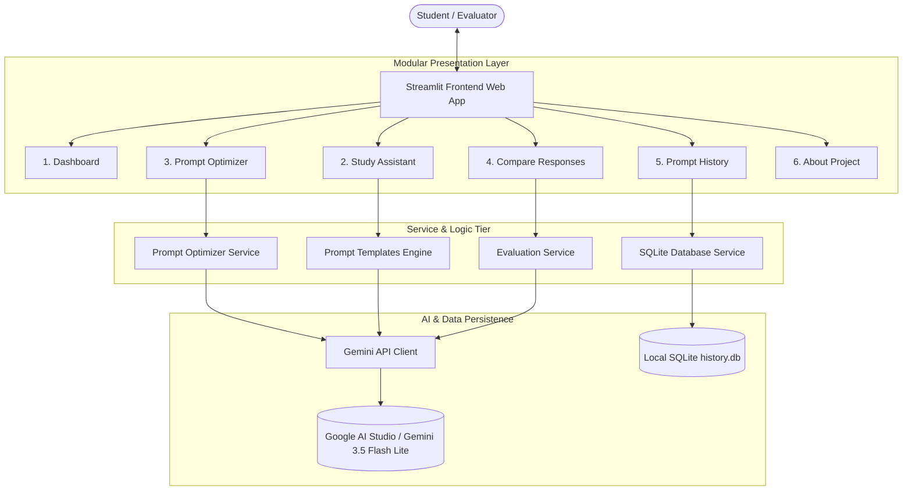
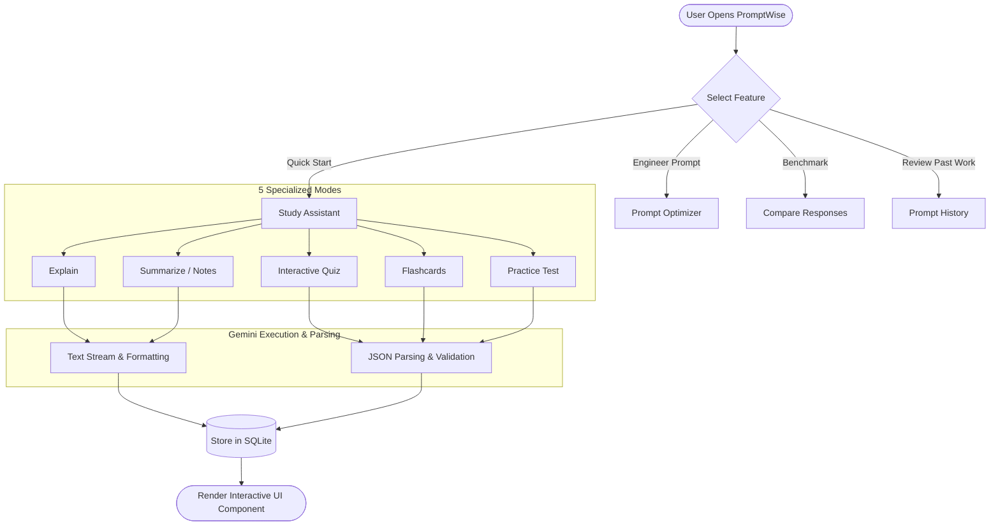
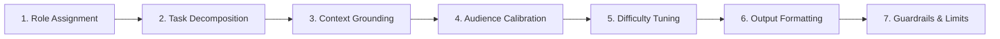

# 📚 PromptWise: AI-Powered Study Assistant

> **"Learn Smarter. Prompt Better."**  
> SCSE4041 Prompt Engineering Mini Project • Team Cognivance • Milestone 2 Upgrade

[](https://promptwise-a7i9rzr9og3ef8hqi26nub.streamlit.app/)
[](https://python.org)
[](https://aistudio.google.com)
[](https://opensource.org/licenses/MIT)

**🌐 Live Web Application:** [https://promptwise-a7i9rzr9og3ef8hqi26nub.streamlit.app/](https://promptwise-a7i9rzr9og3ef8hqi26nub.streamlit.app/)  
**💻 Source Code Repository:** [https://github.com/Yaditiarora/PromptWise](https://github.com/Yaditiarora/PromptWise)

---

## 📖 Executive Summary & Academic Overview

PromptWise is an advanced, production-grade educational study platform designed to demonstrate the practical and empirical value of **Prompt Engineering** in modern Large Language Models (LLMs). Built using **Python**, **Streamlit**, **Google's Gemini API**, and **SQLite**, PromptWise converts vague, unguided student queries into structured, role-grounded prompts that maximize cognitive comprehension, prevent hallucinations, and provide targeted revision.

### 🎯 Problem Statement
Students frequently struggle with:
1. **Ambiguous AI Responses:** Raw prompts (e.g. *"Explain photosynthesis"*) yield generic, poorly structured, or overwhelmingly dense text.
2. **Cognitive Mismatch:** Answers are not calibrated to the student's academic level (School vs. Undergraduate vs. Postgraduate).
3. **Passive Reading vs. Active Recall:** General LLM chat interfaces lack interactive self-testing, flashcard flipping, timed examinations, and targeted weak-concept diagnosis.
4. **Lack of Structure:** Students studying for university or school exams require specific marks-based answers (2, 5, 10 marks), bullet notes, and mnemonics.

### 💡 Project Objectives
- **Demonstrate Empirical Prompt Optimization:** Transform basic prompts through a verifiable **7-Pillar Prompt Engineering framework**.
- **Adaptive Multi-Mode Learning:** Provide 5 distinct pedagogical study modes: Explain, Summarize, Interactive Quiz, Flashcards, and Practice Test.
- **Empirical A/B Benchmarking:** Objectively benchmark and grade basic vs. optimized prompts across 5 dimensions using transparent scoring.
- **Local Persistent Memory:** Maintain an auditable SQLite history of study sessions, prompt evolutions, and evaluations.
- **Zero-Friction Deployment:** Deliver a production-ready application that runs locally or in cloud containers with zero exposed credentials.

---

## 👥 Team Cognivance

| Enrollment No. | Student Name | Role | Core Contributions |
|---|---|---|---|
| **S24CSEU0166** | **Vanshika Beniwal** (Leader) | Prompt Architect | Prompt engineering design, 7-pillar template specification, academic rubric calibration, system evaluation |
| **S24CSEU0241** | **Yaditi Arora** | Full-Stack & AI Engineer | System architecture, Streamlit UI/UX redesign, Gemini API integration, SQLite persistence, deployment |
| **S24CSEU0340** | **Mohita Purohit** | QA & Product Analyst | Test suite execution, verification matrix, response benchmarking, documentation, presentation |

---

## 🏛️ System Architecture

PromptWise follows a clean, decoupled modular architecture separating the user interface, presentation views, prompt orchestration, AI model access, and local persistence.

### High-Level Architecture Diagram



### Application Workflow Diagram



---

## 🔬 The 7 Pillars of Prompt Engineering

PromptWise operationalizes prompt engineering through seven foundational architectural pillars:



1. **Role Assignment:** Assigns an authoritative persona (e.g., *"World-class Computer Science Professor & Academic Mentor"*).
2. **Task Decomposition:** Transforms broad goals into concrete, sequentially ordered execution steps.
3. **Context Grounding:** Anchors the topic to academic curricula, official terminology, and domain boundaries.
4. **Target Audience Calibration:** Calibrates cognitive load and tone for School, Undergraduate, or Postgraduate students.
5. **Difficulty Tuning:**
   - *Beginner:* Accessible vocabulary, foundational analogies, zero assumed prerequisites.
   - *Intermediate:* Academic precision, mechanistic depth, practical industry use cases.
   - *Advanced:* Formal mathematical rigor, theoretical edge cases, architectural trade-offs.
6. **Output Formatting:** Dictates exact Markdown structures, bold definitions, bulleted lists, and takeaways.
7. **Guardrails & Negative Constraints:** Strict rules preventing hallucinations, bounding verbosity, and enforcing academic refusal for non-scholarly topics.

---

## 🗄️ Database Architecture

PromptWise persists student activity, engineered prompts, and evaluation scores using local SQLite storage.

### Schema: `prompt_history`

| Column | Type | Description |
|---|---|---|
| `id` | `INTEGER PRIMARY KEY AUTOINCREMENT` | Unique identifier for each study session |
| `timestamp` | `TEXT NOT NULL` | Date and time formatted as `YYYY-MM-DD HH:MM:SS` |
| `topic` | `TEXT NOT NULL` | Subject matter or academic topic |
| `study_mode` | `TEXT NOT NULL` | Mode used (`Explain`, `Summarize`, `Quiz`, `Flashcards`, `Test`, `Comparison`, etc.) |
| `difficulty` | `TEXT NOT NULL` | Academic level (`Beginner`, `Intermediate`, `Advanced`) |
| `original_prompt` | `TEXT NOT NULL` | Raw user prompt before engineering |
| `optimized_prompt`| `TEXT` | Prompt-engineered instructions sent to Gemini |
| `generated_response`| `TEXT NOT NULL` | AI response content or structured JSON |
| `metadata_json` | `TEXT` | JSON payload containing scores, question data, and rubric items |

### Indexed Fields:
- `idx_topic`: B-Tree index on `topic` for rapid keyword searching.
- `idx_mode`: Index on `study_mode` for fast mode filtering.
- `idx_difficulty`: Index on `difficulty` for level-based filtering.
- `idx_timestamp`: Descending index for real-time chronologically sorted history.

---

## 🌟 Key Application Features

### 1. Dashboard
- **Real-Time Metrics:** Dynamic counters tracking saved study sessions, modes explored, quizzes completed, and prompts engineered.
- **Quick-Start Grid:** 3-and-2 responsive card layout for 1-click launch into any of the 5 study modes.
- **Recent Sessions & Breakdown:** Live activity feed and progress bars showing usage distribution by study mode.

### 2. Study Assistant (5 Core Modes + Exam Answers)
- **📖 Explain:** Concept definitions, progressive step-by-step breakdowns, real-world analogies, and core takeaways.
- **📝 Summarize (Notes):** High-yield bullet points, bold key terms, operational formulas, and mnemonic memory tips.
- **❓ Interactive Quiz:** 5 multiple-choice questions with 4 distinct options (`A`, `B`, `C`, `D`), interactive radio selection, instant scoring, color-coded answer badges, and explanations for each question.
- **🗂️ Interactive Flashcards:** 3D card flip toggle (reveal answer), Previous/Next navigation, progress bar, shuffle functionality, and mastery tracking (*Mastered* vs. *Need Revision*).
- **⏱️ Practice Test:** Timed practice exam with configurable question counts (5, 8, 10), mixed question formats (MCQs + short conceptual answers), elapsed timer, submit button, and automated Gemini evaluation with strengths and targeted revision advice.
- **📝 Exam Answer (Marks-based):** Generates calibrated exam answers matching standard marking criteria: 2 marks (concise 2-3 lines), 5 marks (~120 words with 4 points), and 10 marks (~250 words with intro, sections, and conclusion).
- **🌐 Bilingual Support:** Native English and Roman-script Hinglish options while preserving English technical terminology.

### 3. Prompt Optimizer
- Transforms raw, ambiguous prompts into production-grade prompts integrating all 7 prompt engineering pillars.
- Interactive controls for Target Audience, Difficulty, Desired Output Format, and Custom Guardrails.
- Side-by-side display of **Original Prompt** and **Optimized Prompt** with copy buttons and an explanation of improvements.

### 4. Compare Responses (Empirical A/B Benchmarking)
- Generates side-by-side responses to the same topic using identical model parameters (temperature=0.7):
  - **Response A:** Basic, unengineered prompt.
  - **Response B:** 7-pillar optimized prompt.
- **5-Dimension Evaluation Rubric (Scored 1 to 10):**
  1. *Relevance:* Direct adherence to core topic intent.
  2. *Clarity:* Readability, intuitive flow, and terminology accessibility.
  3. *Completeness:* Depth, coverage of edge cases, and avoidance of critical omissions.
  4. *Structure:* Logical hierarchy, section headings, and ease of scanning.
  5. *Difficulty Alignment:* Calibration to Beginner, Intermediate, or Advanced expectations.
- Calculates an objective overall score, score delta, selected winner, and qualitative comparative verdict.

### 5. Prompt History
- SQLite-backed history management with real-time text search and multi-factor filtering by mode and difficulty.
- Expandable session inspection showing original prompt, optimized prompt, and full formatted response.
- One-click **"Load in Study Assistant"** to re-open previous topics and a single-item deletion option.

---

## 🧪 Verification & Testing Matrix

The project includes an automated end-to-end test suite (`code/test_promptwise_suite.py`) validating all core subsystems.

| Test ID | Module | Test Scenario | Expected Result | Actual Result | Status |
|---|---|---|---|---|---|
| **TC-01** | Database Service | Initialize SQLite DB and verify tables & indexes | Table `prompt_history` and 4 indexes created | Verified schema created successfully | ✅ PASS |
| **TC-02** | Database Service | CRUD Operations (Insert, Query by ID, Delete) | Row inserted with ID, retrieved, and deleted cleanly | Added ID #3, verified data matches, deleted | ✅ PASS |
| **TC-03** | Database Service | Multi-factor filtering & keyword search | Filters by mode and difficulty; search matches substring | Returned matching records correctly | ✅ PASS |
| **TC-04** | Gemini Service | API client initialization & secrets resolution | Loads API key from secrets or environment | Client initialized successfully | ✅ PASS |
| **TC-05** | Gemini Service | Live API generation test | Receives text from `gemini-3.5-flash-lite` | Response received: `PROMPTWISE_READY` | ✅ PASS |
| **TC-06** | JSON Parser | Markdown fenced & unescaped JSON resilience | Parses fenced JSON and strips unescaped LaTeX backslashes | Cleanly decoded into Python dict | ✅ PASS |
| **TC-07** | Prompt Optimizer | 7-Pillar dynamic prompt expansion | Generates structured prompt with role, context & format | Prompt expanded from 23 to 1635 chars | ✅ PASS |
| **TC-08** | Study Assistant | Mode A: Explain generation | Structured explanation with definition, steps & takeaways | Generated 3672 chars of structured output | ✅ PASS |
| **TC-09** | Study Assistant | Mode B: Summarize generation | Bulleted revision notes with bold terms & memory tip | Generated 3121 chars of concise notes | ✅ PASS |
| **TC-10** | Study Assistant | Mode C: Interactive Quiz generation | 5 MCQs with options A-D, answer key, and explanation | Parsed 5 MCQs with options `['A', 'B', 'C', 'D']` | ✅ PASS |
| **TC-11** | Study Assistant | Mode D: Flashcards generation | 6 conceptual cards with front and back | Parsed 6 cards with valid front/back | ✅ PASS |
| **TC-12** | Study Assistant | Mode E: Practice Test generation | Mixed MCQs and conceptual questions with rubric | Parsed 3 mixed questions with answer keys | ✅ PASS |
| **TC-13** | Compare Responses| A/B comparison & 5-dimension evaluation | Both responses generated; Gemini grades on 1-10 scale | Basic: 8.0/10, Optimized: 9.8/10, Winner selected | ✅ PASS |
| **TC-14** | Error Handling | Empty topic submission | Warning displayed; no unhandled API invocation | Warning triggered: "Please provide a study topic" | ✅ PASS |
| **TC-15** | Server Startup | Streamlit headless startup smoke test | Server starts on designated port without error | Uvicorn server started cleanly on port 8501 | ✅ PASS |

To run the automated test suite locally at any time:
```bash
python code/test_promptwise_suite.py
```

---

## 🚀 Installation & Local Setup

### Prerequisites
- Python 3.10, 3.11, 3.12, 3.13, or 3.14
- Google Gemini API Key ([Get one free at Google AI Studio](https://aistudio.google.com/))

### Step-by-Step Setup
1. **Clone the repository:**
   ```bash
   git clone https://github.com/Yaditiarora/PromptWise.git
   cd PromptWise
   ```

2. **Create and activate a virtual environment:**
   ```bash
   python3 -m venv venv
   source venv/bin/activate  # Windows: venv\Scripts\activate
   ```

3. **Install dependencies:**
   ```bash
   pip install -r requirements.txt
   ```

4. **Configure your API credentials:**
   Create `.streamlit/secrets.toml`:
   ```toml
   GEMINI_API_KEY = "your-actual-gemini-api-key-here"
   ```
   *(Alternatively, export `GEMINI_API_KEY="your-key"` in your shell environment).*

5. **Launch PromptWise:**
   ```bash
   streamlit run code/app.py
   ```
   Open your browser to **`http://localhost:8501`**.

---

## ☁️ Deployment Guide (Streamlit Community Cloud)

PromptWise is fully configured for deployment on Streamlit Community Cloud:

1. Fork or push this repository to your GitHub account.
2. Visit **[share.streamlit.io](https://share.streamlit.io)** and sign in with GitHub.
3. Click **"New App"** and select:
   - **Repository:** `Yaditiarora/PromptWise`
   - **Branch:** `main`
   - **Main file path:** `code/app.py`
4. Expand **Advanced Settings ➔ Secrets** and paste your API key:
   ```toml
   GEMINI_API_KEY = "your-actual-gemini-api-key"
   ```
5. Click **Deploy!**

---

## ⚠️ Known Limitations & Future Scope

### Known Limitations
1. **Cloud Container Ephemeral Storage:** On local environments, SQLite persists history permanently in `code/data/history.db`. On Streamlit Community Cloud (which runs on ephemeral container instances), records remain available during an active server session, but reset when the cloud container sleeps or reboots.
2. **Automated Evaluation Heuristics:** Automated response evaluation uses Gemini as an impartial judge based on 5 pedagogical criteria. While LLM-based evaluation provides consistent multi-factor benchmarks, it serves as a pedagogical heuristic rather than an absolute formal grading metric.
3. **API Rate Limits:** Free-tier Gemini API keys are subject to Google's standard rate limits (15 RPM / 429 quota limits). PromptWise includes exponential backoff retry logic, but heavy burst traffic may require brief cooldown periods.

### Future Scope
- **Document Grounding (RAG):** Enable students to upload PDF textbooks or lecture slide decks for syllabus-grounded answer generation.
- **Exporting Options:** One-click PDF or Anki deck (`.apkg`) export for generated flashcards and revision notes.
- **Voice Interactivity:** Multimodal audio integration using Gemini Live API for spoken conversational tutoring.

---

## 🔒 Security & Privacy Notice
- API keys are **never** committed to version control, logged in application logs, or rendered in frontend UI.
- All credentials are read strictly through Streamlit Secrets or environment variables and protected by `.gitignore`.
- SQLite storage holds academic prompt text only and excludes any personal user credentials.

---

## 📄 License
This project is open-source and available under the [MIT License](https://opensource.org/licenses/MIT).
